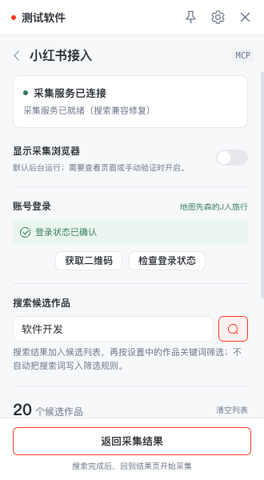
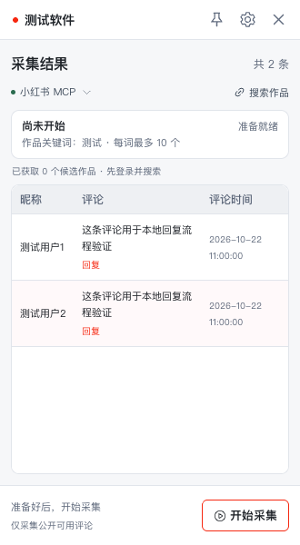
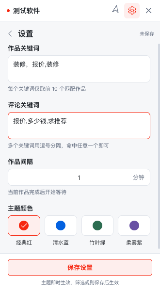

<div align="center">

# 小红书评论采集工作台

面向 Windows 的小红书公开评论采集工具。通过 `xiaohongshu-mcp` 登录、搜索候选作品、读取评论，并按评论关键词和屏蔽词筛选结果。

**仅支持 Windows 10 / 11 x64。**

[下载安装](../../releases) · [使用方法](#使用方法) · [问题反馈](../../issues)

</div>

## 功能

- 小红书 MCP 登录、搜索候选作品和读取公开评论
- 候选作品预览、详情跳转和逐条移除
- 评论关键词组合、组合自定义名称和评论屏蔽词
- 每次采集数量、作品发布时间范围、作品采集间隔
- 失败暂停、当前作品重试、任务暂停与继续
- 评论去重、重复采集结果提示和 CSV 导出
- 手动回复评论，并支持配置回复间隔
- 主题切换、窗口置顶和本地数据持久化

## 下载安装

打开 [GitHub Releases](../../releases)，下载最新版本的：

```text
xiaohongshu-版本号-windows-x64-setup.exe
```

双击安装包后按向导安装。当前安装包没有配置 Windows 代码签名，系统可能显示“未知发布者”；请确认下载来源为本仓库。程序首次使用时会安装并管理小红书 MCP 组件及配套浏览器，可能需要等待一段时间。

本项目只发布 Windows x64 安装包，不提供 macOS、Linux、Windows ARM64 或 32 位版本。

## 使用方法

1. 启动程序，打开「登录 / 搜索」，点击「安装 / 启动服务」。
2. 点击「获取二维码」，使用小红书 App 扫码并确认，再点击「检查登录状态」。
3. 输入搜索词，搜索结果会累积到候选作品列表。
4. 在「采集预览」中查看候选作品，点击标题可打开小红书详情；不需要的作品可以移除。
5. 返回结果页，在设置中填写评论关键词和屏蔽词，设置每次采集数量、作品间隔和回复间隔。
6. 点击「开始采集」。读取失败会暂停在当前作品，修复登录或验证状态后点击「重试」。
7. 采集完成后可以在结果页查看评论、手动回复或导出 CSV。

作品标题筛选由小红书搜索完成，设置页不再重复配置标题关键词。评论筛选组合支持自定义名称；命中屏蔽词的评论会直接隐藏。

## 评论读取范围

每个作品最多读取 200 条一级评论，包含这些评论实际返回的回复，不自动展开全部楼中楼。平台返回不完整、登录失效、页面验证、网络错误或接口结构变化时，任务会暂停并保留当前进度，不会把不完整结果伪装成成功。

评论按作品顺序串行读取。作品之间使用设置的采集间隔；手动回复使用单独的回复间隔，成功回复后至少等待该时间。设置为 0 秒表示不等待。

## 项目界面

登录并搜索候选作品：



采集结果与手动回复：



筛选关键词、屏蔽词和采集规则：



## 数据安全

- 登录会话由本机的小红书 MCP 组件保存，应用不收集账号密码，也不把账号信息、候选作品或评论上传到本项目服务器。
- 候选作品、评论结果、设置和回复记录保存在当前 Windows 用户的本地目录 `%APPDATA%/xiaohongshu/collector/`。
- 导出的 CSV 只会写入用户主动选择的保存位置；应用不会自动上传或分享导出文件。
- 回复操作会先在本地保存发送状态。平台返回不明确时会显示待确认，避免程序自动重复发送。
- 重置采集只清空本地候选作品和采集结果，不会删除小红书上的评论、作品或回复。
- 请不要把设置文件、回复记录、导出文件或日志发送给他人，其中可能包含评论内容、作品链接和账号相关信息。

## 免责声明

本项目是面向公开内容采集的个人工具，与小红书及其关联公司没有官方关系。使用者应自行确认账号、作品和评论数据的使用权限，并遵守适用法律法规、平台服务条款和社区规则。

本项目不保证评论读取完整、登录状态持续有效、平台接口长期兼容或回复一定送达。平台可能因访问频率、页面验证、账号状态或接口变化限制访问；任何采集间隔和回复间隔设置都不能消除账号受限风险。请勿用于刷屏、骚扰、批量营销、侵犯隐私或其他违反平台规则的行为。因使用本软件造成的账号限制、数据损失、内容纠纷或其他损失，由使用者自行承担。

## 上游组件与许可

本项目集成 [xpzouying/xiaohongshu-mcp](https://github.com/xpzouying/xiaohongshu-mcp)，当前固定版本见 `resources/xiaohongshu-mcp/manifest.json`。上游许可证副本位于 `resources/xiaohongshu-mcp/LICENSE`。

本项目仅供学习和研究使用。请遵守法律法规、小红书平台规则和账号权限边界，不要进行刷屏、骚扰、营销滥用或侵犯隐私的操作。
